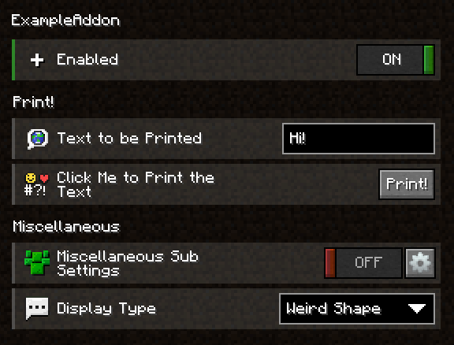

From using our predefined setting widgets over creating your own, to a few things that didn't fit in with the rest. This page will show you everything there is to know about our configuration system.

## Create a Basic Configuration

You can create your configuration by creating a new class and inheriting `AddonConfig`. This superclass requires you to implement the `enabled` method, as we want to allow servers to disable every addon they want. 

The only thing you always need to keep in mind while creating a configuration besides the type you need to inherit is that you need to use the `ConfigProperty` type for your settings, but just for specific types that you might want to use. More on which types you can use by default [here](#setting-types). For any other types, use the type itself without declaring it as an argument on `ConfigProperty`.

To create a setting that represents if your addon is enabled or not, you need to create a new field with the type `ConfigProperty`. Now add the type of your setting, in this case, `Boolean` as boolean. Now instantiate this property by declaring a new ConfigProperty with the default value as the argument, well use `true` as the default value.
The result would look like this `ConfigProperty<Boolean> enabled = new ConfigProperty<>(true)`. Now, if we want to use this property in an event, we'll get the property (preferably by its getter) and call `get()`. This will get us the value of the property.

### Setting types

You can only use various types for your `ConfigProperty` by default. <br>
The current valid types are:

 + String
 + Character
 + Boolean
 + Integer
 + Long
 + Double
 + Float
 + Short
 + Byte
 + any Enum
 + Key
 + MouseButton
 + ResourceLocation
 + Color (`net.labymod.api.util`)

## Using Predefined Setting Widgets

The following content lists all of our Setting Widgets that will be served by using the Addon API, with possible arguments (brackets surround optional arguments), compatible types, and a short description that you can create via an annotation:

Annotation: `SwitchSetting` <br>
Arguments: none <br>
Compatible Type: `Boolean` <br>
Description: Allows the player to enable or disable an on/off switch.

### Slider Widget

Annotation: `SliderSetting` <br>
Arguments: `min` - smallest value possible, `max` - biggest value possible, (`steps` - the amount of how much the value will increase/decrease on each move - default is 1) <br>
Compatible Types: `Integer`, `Float`, `Double`, `Short`, `Byte`, `Long` <br>
Description: Allows the player to select a number in a specific range on a slider

### Text Field Widget

Annotation: `TextFieldSetting` <br>
Arguments: (`maxLength` - the maximal length of the string entered) <br>
Compatible Type: `String` <br>
Description: Allows the player to freely type any string

### Key Bind Widget

Annotation: `KeyBindSetting` <br>
Arguments: (`acceptMouseButtons` - whether the user should be able to select mouse buttons - default is false) <br>
Compatible Type: `Key` <br>
Description: Allows the player to select a mouse or keyboard button. Most commonly used for shortcuts

### Multi Key Bind Widget

Annotation: `MultiKeyBindSetting` <br>
Arguments: none <br>
Compatible Type: `Key[]` <br>
Description: Allows the player to select multiple keyboard buttons. Most commonly used for shortcuts

### Color Picker Widget

Annotation: `ColorPickerSetting` <br>
Arguments: (`alpha` - whether the user should be able to change the transparency - default is false, `chroma` - whether the user should be able to add the rgb/chroma effect to the color - default is false, `chromaSpeed` - whether the user should be able to change the chroma speed value of the color - default is `true`) <br>
Compatible Type: `Integer` <br>
Description: Allows the player to select a color from a hex color picker

### Dropdown Widget

Annotation: `DropdownSetting` <br>
Arguments: none <br>
Compatible Types: any enum <br>
Description: Displays an enum as a dropdown menu and lets the player choose an option

### Button Widget

Annotation: `ButtonSetting` <br>
Arguments: none <br>
Compatible Types: any public void method annotated with `@MethodOrder` and with a `Setting` object as the only parameter. <br>
Description: Executes a method with custom code when clicked

### Activity Widget

Annotation: `ActivitySetting` <br>
Arguments: none <br>
Compatible Types: any public method that returns an [`Activity`](../activities/activity.md), <b>not `ConfigProperty`</b> <br>
Description: Opens an activity in a new window

### Advanced Selection Widget

Annotation: `AdvancedSelectionSetting` <br>
Arguments: none <br>
Compatible Types: any of the default types mentioned above <br>
Description: A horizonal field list where the user can select one option. This is used for the theme selector for example.

### Tag Input Widget

Annotation: `TagInputSetting` <br>
Arguments: none <br>
Compatible Types: `TagCollection` <br>
Description: Basically acts as an array of strings where the player can add and remove strings as he wishes

### Item Stack Widget

Annotation: `ItemStackSetting` <br>
Arguments: none <br>
Compatible Types: `ItemStack`, `ItemData` <br>
Description: Allows the player to select the item stack which they're holding ingame

### File Chooser Widget

Annotation: `FileChooserSetting` <br>
Arguments: (`extensions`: an array of allowed file extensions) <br>
Compatible Types: `Path` <br>
Description: Allows the player to select a path to a file or a directory

## Further Customize the Settings

In addition to using predefined widgets for your settings, you also have a few other options to customize them. <br>
The following points are not very precisely explained, but you can see everything from the following subsections and most of the subsections before in [this section](#example-of-the-previous-sections).

### Create Sections

You can create sections in your settings; you just have to add the annotation `@SettingSection` above the first field that you want to have in said section. Now all you have to do is set the identifier as the annotation's `value` parameter and add it to your internationalization file. You can also center the section title by passing the `center` annotation parameter as `true`.

### Create Sub Settings

If you want more structure in your settings but don't want to use Sections, you can create sub-settings that can be accessed via a button. Just create a new class, and let it inherit from `Config`. Add a field with the same type in your configuration (just the type, not a `ConfigProperty`) and create a new instance of said class. You might have noticed that you don't have to use the `AddonConfig` superclass for sub-settings. The `AddonConfig` class is required for your main configuration but not for sub-settings.

If you want to display more than just the advanced button (the button that lets you access the sub-settings), add the `@ShowSettingInParent` annotation to the most important switch in your sub-settings.

### Use Icons for Settings

To display icons in front of your settings, you'll need to declare a sprite texture with the `@SpriteTexture` annotation. Set the name of your file as the value of the annotation (the base path is `assets/NAMESPACE/themes/THEME/textures/sprite`, while the namespace is the namespace you set in your `build.gradle.kts` and the theme to the current theme. If you want your icons to be visible in all themes, put the texture in the vanilla theme). More on sprite textures [here](#FINAL-LINK-HERE).

## Example of the Previous Sections

These are some example files showing a few of the functions mentioned before.

=== ":octicons-file-code-16: ExampleConfiguration"
    ```java
    @ConfigName("settings")
    @SpriteTexture("example_sprite.png")
    public class ExampleConfiguration extends AddonConfig {
    
      @SpriteSlot(x = 1, y = 1)
      @SwitchSetting
      private ConfigProperty<Boolean> enabled = new ConfigProperty<>(true);

      @SettingSection("print")
      @SpriteSlot(x = 6)
      @TextFieldSetting
      private ConfigProperty<String> text = new ConfigProperty<>("Hello World!");

      @SettingSection("miscellaneous")
      @SpriteSlot(x = 1, y = 3)
      private ExampleSubSettings subSettings = new ExampleSubSettings();

      @SpriteSlot(y = 3)
      @DropdownSetting
      private ConfigProperty<ExampleEnum> type = new ConfigProperty<>(ExampleEnum.SCALENE_TRIANGLE);

      @MethodOrder(after = "text")
      @SpriteSlot(x = 2, y = 6)
      @ButtonSetting
      public void print(Setting setting) {
        Notification.Builder builder = Notification.builder()
            .title(Component.text("INFO"))
            .text(Component.text(setting.getId() + " was clicked! " + this.text))
            .type(Type.SYSTEM);
        Laby.labyAPI().notificationController().push(builder.build());
      }

      @Override
      public ConfigProperty<Boolean> enabled() {
        return this.enabled;
      }
    }
    ```

=== ":octicons-file-code-16: ExampleSubSetting"
    ```java
    public class ExampleSubSettings extends Config {
    
      @ShowSettingInParent
      @SpriteSlot(x = 7)
      @SwitchSetting
      private ConfigProperty<Boolean> enabled = new ConfigProperty<>(true);

      @SpriteSlot(x = 1, y = 6)
      @ColorPickerSetting
      private ConfigProperty<Integer> labyModColor = new ConfigProperty<>(
          new Color(10, 85, 165).getRGB());

      @SpriteSlot(x = 2)
      @KeyBindSetting
      private ConfigProperty<Key> keyBind = new ConfigProperty<>(Key.F);
    }
    ```

=== ":octicons-file-code-16: ExampleEnum"
    ```java
    public enum ExampleEnum {
        HEART, CIRCLE, RECTANGLE, TRIANGLE, SCALENE_TRIANGLE;
    }
    ```

=== ":octicons-file-code-16: en_us.json"
    ```json
    {
      "example": {
        "settings": {
          "name": "ExampleAddon",
          "enabled": {
            "name": "Enabled"
          },
          "text": {
            "name": "Text to be Printed"
          },
          "print": {
            "name": "Click Me to Print the Text",
            "text": "Print!"
          },
          "subSettings": {
            "name": "Miscellaneous Sub Settings",
            "labyModColor": {
              "name": "The LabyMod Color"
            },
            "keyBind": {
              "name": "Key Bind"
            }
          },
          "type": {
            "name": "Display Type",
            "entries": {
              "heart": "Heart",
              "circle": "Circle",
              "rectangle": "Rectangle",
              "triangle": "Triangle",
              "scaleneTriangle": "Weird Shape"
            }
          },
          "header": {
            "print": {
              "name": "Print!"
            },
            "miscellaneous": {
              "name": "Miscellaneous"
            }
          }
        }
      }
    }
    ```

=== ":octicons-file-media-24: Result"
    

## Mark config options as introduced in a specific update

Sometimes you add a new setting to your config and want to highlight it to your users as part of an update.
To achieve this, Laby Client provides **revisions**. A revision acts like a milestone: it documents an update with a version and associates it with a release date. Config options can then be annotated with this revision to automatically display a **“new” badge** for a limited time.

### Create and register a revision

Let’s say you’re releasing an update for your addon with the version `1.0.1`.
Before your configuration is loaded, you need to register a revision so it can be used in your config.

1. Override the `preConfigurationLoad` method in your `LabyAddon` class.
2. Inside it, register a new revision via the `RevisionRegistry`, accessible through `Laby.references().revisionRegistry()`.
3. Use a `SimpleRevision` object to register:
    * **Namespace:** your addon namespace (`"example"` in this guide).
    * **Version:** a `SemanticVersion` object, e.g. `new SemanticVersion("1.0.1")`.
    * **Date:** release date in `YYYY-MM-DD` format. This controls how long the “new” badge is displayed (exactly 12 days).

### Associate a setting with a revision

Once a revision is registered, you can immediately use it in your config.
To do this, annotate a config option with the `@IntroducedIn` annotation.

* The `namespace` parameter should match the namespace you registered.
* The `value` parameter should match the revision’s version string.

And that’s it - Laby Client will now automatically mark this setting as **new** for your users.

### Example of applying a revision

=== ":octicons-file-code-16: ExampleAddon"
    ```java
    public class ExampleAddon extends LabyAddon<ExampleConfiguration> {

      @Override
      protected void preConfigurationLoad() {
        Laby.references().revisionRegistry().register(new SimpleRevision(
          "example",
          new SemanticVersion("1.0.1"),
          "2025-10-06"
        ));
      }
    }
    ```

=== ":octicons-file-code-16: ExampleConfiguration"
    ```java
    @ConfigName("settings")
    public class ExampleConfiguration extends AddonConfig {

      @SwitchSetting
      private final ConfigProperty<Boolean> enabled = new ConfigProperty<>(true);

      @TextFieldSetting
      private final ConfigProperty<String> oldConfigOption = new ConfigProperty<>("");

      @IntroducedIn(namespace = "example", value = "1.0.1")
      @SliderSetting(min = 1, max = 10)
      private final ConfigProperty<Integer> brandNewConfigOption = new ConfigProperty<>(7);

      public ConfigProperty<Boolean> enabled() {
          return this.enabled;
      }
    }
    ```

=== ":octicons-file-media-24: Result"
    

## Config Versioning
If you want to push an update for your addon which breaks existing configs it would be a great idea to write a little config migrator class which converts the old JSON file to your new config format.
The first step would be increasing the current version of your addon config by one. You do so by overriding the `AddonConfig#getConfigVersion` method in your config implementation.
```java
@Override
public int getConfigVersion() {
  return 2;
}
```
The next step is creating a class which actually migrates the old config values to the new one.
=== ":octicons-file-code-16: ConfigVersionListener"
```java
public class ConfigVersionListener {
  
  @Subscribe
  public void onConfigVersionUpdate(ConfigurationVersionUpdateEvent event) {
    // Get the config class so you can differantiate which config is being updated
    Class<? extends Config> configClass = event.getConfigClass();
    // This is the version which the old config is in
    int usedVersion = event.getUsedVersion();

    // Check if it's really your config
    if (configClass == YourConfigClass.class) {
      if (usedVersion == 1) {
        // The current config JSON object
        JsonObject config = event.getJsonObject();

        // Keep the value of a renamed ConfigProperty
        if(config.has("oldConfigOptionName")) {
          // You'd have to adapt the #getAsString to your property type of course
          config.set("newConfigOptionName", config.get("oldConfigOptionName").getAsString());
        }

        // Add default values to a newly created array
        JsonArray myNewArrayProperty = new JsonArray();
        // JsonArray#add(String) can't be used unfortunately because the method does not exist in the gson version used in labymod 1.8
        myNewArrayProperty.add(new JsonPrimitive("array value number 1"));
        myNewArrayProperty.add(new JsonPrimitive("array value number 2"));
        myNewArrayProperty.add(new JsonPrimitive("array value number 3"));

        config.add("myNewArrayProperty", myNewArrayProperty);

        /*
          You don't really have to remove old JSON values of removed ConfigProperties
          as they're removed when the config is being loaded anyway
        */

        // Finally set the modified config object
        event.setJsonObject(config);
      } else if (usedVersion == 2) {
        // If the addon's config is already on version 2 and you need to migrate it to version 3 for example
      }
    }
  }
}
```
